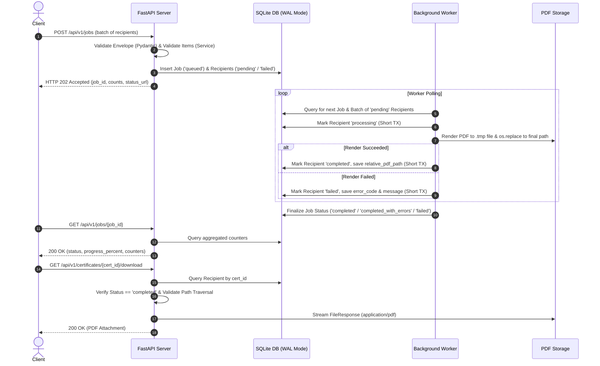

# Bulk Certificate Generator — Grahith Rao

A resilient, asynchronous batch certificate generation pipeline engineered with **FastAPI**, **SQLAlchemy 2.x**, **SQLite (WAL mode)**, **Pydantic v2**, and **ReportLab**.

**Project Owner & Developer:** Grahith Rao  
**Architecture:** Asynchronous DB-backed job queue with a standalone single-worker process  

---

## 1. Project Overview & Features

This system provides a reliable backend service to handle bulk certificate generation requests. It decouples incoming batch requests from CPU-intensive PDF rendering, isolates failures so that invalid recipients or rendering glitches never block valid recipients, tracks fine-grained progress in real time, and securely serves rendered PDF certificates.

### Key Architectural Capabilities
- **Non-blocking Job Ingestion:** Batches are validated and recorded immediately, returning `HTTP 202 Accepted` (or `HTTP 201 Created` for all-invalid diagnostic runs) in milliseconds.
- **Envelope vs. Recipient Validation Separation:** Malformed individual recipient rows (bad emails, missing names, invalid types) do not cause FastAPI/Pydantic to reject the entire batch with `422`. Instead, each entry is persisted at its original `input_index` with diagnostic failure codes (`INVALID_NAME`, `INVALID_EMAIL`, `DUPLICATE_RECIPIENT`, `INVALID_PAYLOAD`).
- **Deterministic Batch Deduplication:** Automatically normalizes recipient emails (case-insensitive, whitespace-trimmed) within a batch; the first occurrence is queued while subsequent occurrences are marked as `DUPLICATE_RECIPIENT`.
- **Durable DB-Backed Job Queue:** No heavy dependencies like Redis or RabbitMQ are required. SQLite in **Write-Ahead Logging (WAL)** mode enables concurrent reads and writes without contention.
- **Atomic PDF Generation:** Renders landscape certificates to temporary files and atomically renames them (`os.replace`) upon successful generation, eliminating corrupted or partial files.
- **Crash & Restart Recovery:** A built-in recovery policy detects interrupted jobs and recipients on worker startup, resetting unfinished work from `processing` to `pending` while strictly preserving already-completed certificates without redundant re-generation.
- **Single-Worker Concurrency Guard:** Utilizes an advisory operating-system file lock (`fcntl.flock`) to prevent multiple workers from running concurrently and racing on SQLite state.
- **Directory Traversal Protection:** Download endpoints strictly validate stored relative paths against canonical storage roots before streaming files.
- **Unicode & Typography Excellence:** Uses bundled DejaVu TrueType fonts with paired serif typography (`DejaVuSerif-Bold`) for recipient names and main headings, and clean sans-serif (`DejaVuSans`) for metadata. Provides comprehensive Unicode diacritic coverage with dynamic font scaling.
- **Polished Light Theme UI & Live Preview:** A clean, accessible light-theme interface (`#F8FAFC`, `#2563EB`, `#B89B5E`) with responsive two-column layout on desktop, real-time embedded PDF preview, batch submission, live polling, and instant downloads.

### Architecture Overview


### Project Directory Structure
```text
.
├── .env.example                     # Environment template
├── .gitignore                        # Git exclusion rules (DB, PDFs, caches)
├── pyproject.toml                    # Project metadata, pytest & ruff configurations
├── requirements.txt                  # Locked Python dependencies
├── alembic.ini                       # Alembic migration configuration
├── README.md                         # Project documentation and guide
├── INTERVIEW_GUIDE.md                # Detailed technical interview walkthrough
├── alembic/
│   ├── env.py                        # Alembic migration environment
│   └── versions/                     # Versioned migration scripts
├── app/
│   ├── __init__.py
│   ├── main.py                       # FastAPI application, lifespan, exception sanitization
│   ├── config.py                     # Pydantic BaseSettings configuration
│   ├── database.py                   # SQLAlchemy engine, session factory, SQLite WAL pragmas
│   ├── models.py                     # Job and Recipient SQLAlchemy models
│   ├── schemas.py                    # Pydantic v2 schemas and validation logic
│   ├── worker.py                     # Durable worker process, crash recovery, file locking
│   ├── api/
│   │   ├── __init__.py
│   │   └── routes.py                 # Versioned API routes (/api/v1/jobs, /certificates)
│   └── services/
│       ├── __init__.py
│       ├── jobs.py                   # Batch validation, deduplication, progress counters
│       └── certificates.py           # ReportLab PDF rendering, font init, atomic file write
├── assets/
│   └── fonts/
│       ├── DejaVuSans.ttf            # Bundled TrueType regular font
│       ├── DejaVuSans-Bold.ttf       # Bundled TrueType bold font
│       ├── DejaVuSerif.ttf           # Bundled TrueType serif regular font
│       ├── DejaVuSerif-Bold.ttf      # Bundled TrueType serif bold font
│       └── LICENSE.txt               # DejaVu font license notice
├── sample_requests/
│   ├── valid_batch.json              # 100% valid sample batch
│   ├── mixed_batch.json              # Mixed batch (valid, invalid name, bad email, duplicate)
│   ├── all_invalid_batch.json        # All-invalid diagnostic batch
│   └── long_names_unicode_batch.json # International diacritics & long titles
├── static/
│   ├── index.html                    # Demo UI dashboard
│   ├── style.css                     # Custom responsive light-theme styling
│   └── app.js                        # Vanilla JS client for submission & polling
├── storage/
│   └── certificates/                 # Generated PDF storage directory (.gitkeep preserved)
└── tests/
    ├── __init__.py
    ├── conftest.py                   # Pytest fixtures (isolated DB & temp storage)
    ├── test_jobs_api.py              # Ingestion, envelope & recipient validation tests
    ├── test_certificates_api.py      # Download security, 404, 409, missing file, preview tests
    ├── test_rendering.py             # ReportLab PDF generation & pypdf text inspection
    ├── test_worker.py                # Batch processing, failure isolation, locking tests
    └── test_restart_recovery.py      # Crash recovery & idempotency tests
```

---

## 2. Technology Stack & Prerequisites

- **Python Version:** Python 3.11 or newer (tested on Python 3.14)
- **Web Framework:** [FastAPI](https://fastapi.tiangolo.com/) with [Uvicorn](https://www.uvicorn.org/)
- **Data Validation:** [Pydantic v2](https://docs.pydantic.dev/latest/) & `email-validator`
- **Database & ORM:** [SQLAlchemy 2.x](https://www.sqlalchemy.org/) with SQLite (WAL mode, foreign keys enabled)
- **Database Migrations:** [Alembic](https://alembic.sqlalchemy.org/)
- **PDF Generation Engine:** [ReportLab](https://www.reportlab.com/)
- **PDF Inspection & Testing:** [pypdf](https://pypdf.readthedocs.io/) & [pytest](https://docs.pytest.org/)
- **Code Quality:** [Ruff](https://docs.astral.sh/ruff/)

---

## 3. Installation & Setup

### macOS & Linux
```bash
# 1. Clone or navigate to the repository directory
cd /path/to/intern

# 2. Create and activate a Python virtual environment
python3 -m venv .venv
source .venv/bin/activate

# 3. Upgrade pip and install dependencies
pip install --upgrade pip
pip install -r requirements.txt
```

### Windows (PowerShell)
```powershell
# 1. Navigate to the repository directory
cd C:\path\to\intern

# 2. Create and activate a Python virtual environment
python -m venv .venv
.venv\Scripts\Activate.ps1

# 3. Upgrade pip and install dependencies
python -m pip install --upgrade pip
pip install -r requirements.txt
```

---

## 4. Environment Configuration

Copy the example configuration file:
```bash
cp .env.example .env
```

Default settings in `.env`:
```ini
APP_NAME="Grahith Rao | Bulk Certificate Generator"
ENVIRONMENT="development"
DEBUG=false

# SQLite Database in root directory
DATABASE_URL="sqlite:///./certificates.db"

# Storage Directories
STORAGE_DIR="./storage"
FONTS_DIR="./assets/fonts"

# Batch and Worker Parameters
MAX_BATCH_SIZE=1000
WORKER_POLL_INTERVAL=1.0
WORKER_BATCH_SIZE=50
```

---

## 5. Database Setup & Migrations

The project is pre-configured with Alembic migrations:
```bash
# Apply migrations to create the database schema
alembic upgrade head
```
*(Note: The application also checks and auto-initializes database tables on startup if migrations have not yet been run.)*

---

## 6. Running the Application

This architecture requires two processes: the **FastAPI Web API** and the **Standalone Worker**.

### Terminal 1: Launch FastAPI Server
```bash
# Activate virtual environment
source .venv/bin/activate

# Run Uvicorn development server
uvicorn app.main:app --host 127.0.0.1 --port 8000 --reload
```
- Interactive Swagger / OpenAPI Documentation: **[http://127.0.0.1:8000/docs](http://127.0.0.1:8000/docs)**
- Interactive Demo Dashboard: **[http://127.0.0.1:8000/](http://127.0.0.1:8000/)**
- Service Health Check: **[http://127.0.0.1:8000/health](http://127.0.0.1:8000/health)**

### Terminal 2: Launch Background Worker
```bash
# Activate virtual environment
source .venv/bin/activate

# Run the durable worker process
python -m app.worker
```
The worker will:
1. Acquire the OS-level lock `.worker.lock`.
2. Execute restart recovery on interrupted jobs or recipients.
3. Poll SQLite for pending recipient batches and generate PDF certificates.

---

## 7. API Contract & Working `curl` Examples

### 1. Submit a Certificate Generation Batch
**Endpoint:** `POST /api/v1/jobs`

```bash
curl -X POST http://127.0.0.1:8000/api/v1/jobs \
  -H "Content-Type: application/json" \
  -d '{
    "event_name": "Python Backend Development Workshop",
    "issuer_name": "Example Learning Academy",
    "issue_date": "2026-10-11",
    "recipients": [
      {
        "name": "Aarav Sharma",
        "email": "aarav@example.com"
      },
      {
        "name": "Diya Rao",
        "email": "diya@example.com"
      }
    ]
  }'
```

**HTTP 202 Response:**
```json
{
  "job_id": "0602fba7-0efc-4e8c-8f9f-ec387ffbaea4",
  "status": "queued",
  "total": 2,
  "accepted": 2,
  "rejected": 0,
  "status_url": "/api/v1/jobs/0602fba7-0efc-4e8c-8f9f-ec387ffbaea4",
  "message": "Job accepted for asynchronous certificate generation."
}
```

---

### 2. Poll Job Status & Progress
**Endpoint:** `GET /api/v1/jobs/{job_id}`

```bash
curl http://127.0.0.1:8000/api/v1/jobs/0602fba7-0efc-4e8c-8f9f-ec387ffbaea4
```

**HTTP 200 Response:**
```json
{
  "job_id": "0602fba7-0efc-4e8c-8f9f-ec387ffbaea4",
  "event_name": "Python Backend Development Workshop",
  "issuer_name": "Example Learning Academy",
  "issue_date": "2026-10-11",
  "status": "completed",
  "created_at": "2026-10-11T13:45:00.000000Z",
  "started_at": "2026-10-11T13:45:01.000000Z",
  "finished_at": "2026-10-11T13:45:02.000000Z",
  "counts": {
    "total": 2,
    "processed": 2,
    "completed": 2,
    "failed": 0,
    "pending": 0,
    "processing": 0
  },
  "progress_percent": 100.0,
  "recipients_url": "/api/v1/jobs/0602fba7-0efc-4e8c-8f9f-ec387ffbaea4/recipients"
}
```

---

### 3. Retrieve Paginated Recipient Outcomes
**Endpoint:** `GET /api/v1/jobs/{job_id}/recipients?page=1&page_size=50`

```bash
curl "http://127.0.0.1:8000/api/v1/jobs/0602fba7-0efc-4e8c-8f9f-ec387ffbaea4/recipients?page=1&page_size=50"
```

**HTTP 200 Response:**
```json
{
  "job_id": "0602fba7-0efc-4e8c-8f9f-ec387ffbaea4",
  "total": 2,
  "page": 1,
  "page_size": 50,
  "total_pages": 1,
  "items": [
    {
      "id": "e6a17bbf-1234-4567-89ab-cdef01234567",
      "input_index": 0,
      "name": "Aarav Sharma",
      "email": "aarav@example.com",
      "status": "completed",
      "error_code": null,
      "error_message": null,
      "certificate_id": "CERT-8D3A1B4C9E0F",
      "download_url": "/api/v1/certificates/CERT-8D3A1B4C9E0F/download",
      "created_at": "2026-10-11T13:45:00.000000Z",
      "updated_at": "2026-10-11T13:45:02.000000Z",
      "processed_at": "2026-10-11T13:45:02.000000Z"
    }
  ]
}
```

---

### 4. Download Generated PDF Certificate
**Endpoint:** `GET /api/v1/certificates/{certificate_id}/download`

```bash
curl -O -J http://127.0.0.1:8000/api/v1/certificates/CERT-8D3A1B4C9E0F/download
```
- Returns `Content-Type: application/pdf`
- Returns `Content-Disposition: attachment; filename="certificate_CERT-8D3A1B4C9E0F.pdf"`
- Responds with `409 Conflict` if the certificate is still pending/processing or failed.
- Responds with `404 Not Found` if the certificate does not exist or the file was deleted.

---

### 5. Preview Certificate Template
**Endpoint:** `GET /api/v1/certificates/preview`

```bash
curl "http://127.0.0.1:8000/api/v1/certificates/preview?recipient_name=Jane+Doe&event_name=Workshop" -o preview.pdf
```
- Streams an inline vector PDF rendered on-the-fly using the active ReportLab template.
- Supports query parameters: `recipient_name`, `event_name`, `issuer_name`, `issue_date`, `certificate_id`.

---

## 8. Mixed-Validity Sample Request Walkthrough

You can test failure isolation directly using `sample_requests/mixed_batch.json`:

```bash
curl -X POST http://127.0.0.1:8000/api/v1/jobs \
  -H "Content-Type: application/json" \
  -d @sample_requests/mixed_batch.json
```

**Submitted Payload:**
```json
{
  "event_name": "Modern Cloud Architecture Symposium",
  "issuer_name": "DevOps Institute of Technology",
  "issue_date": "2026-10-15",
  "recipients": [
    {"name": "Aarav Sharma", "email": "aarav@example.com"},
    {"name": "   ", "email": "blank_name@example.com"},
    {"name": "Diya Rao", "email": "diya@example.com"},
    {"name": "Carlos Mendoza", "email": "not-an-email"},
    {"name": "Diya Rao Duplicate", "email": "diya@example.com"},
    "malformed_non_object_entry"
  ]
}
```

**Outcome:**
1. Ingestion returns `HTTP 202 Accepted` (`accepted: 2`, `rejected: 4`).
2. Input index 0 (`Aarav Sharma`) and 2 (`Diya Rao`) are marked `pending` and processed into valid PDF certificates.
3. Input index 1 is recorded as `failed` with code `INVALID_NAME`.
4. Input index 3 is recorded as `failed` with code `INVALID_EMAIL`.
5. Input index 4 is recorded as `failed` with code `DUPLICATE_RECIPIENT` (referencing first occurrence at index 2).
6. Input index 5 is recorded as `failed` with code `INVALID_PAYLOAD`.
7. Once processing completes, the job reaches terminal status: **`completed_with_errors`**.

---

## 9. Status Lifecycle & Validation Policies

### Job Status Transitions
- `queued`: Batch ingested with at least 1 valid recipient awaiting worker pickup.
- `processing`: Worker has claimed the job and is generating certificates.
- `completed`: All submitted recipients were successfully processed into certificates.
- `completed_with_errors`: Some recipients completed, while others failed validation or rendering.
- `failed`: No recipients succeeded (all-invalid batch or all failed during processing).

### Progress Counters
- $\text{total} = \text{number of submitted entries}$
- $\text{processed} = \text{completed} + \text{failed}$
- $\text{remaining} = \text{pending} + \text{processing}$
- $\text{progress\_percent} = \frac{\text{processed}}{\text{total}} \times 100$

All counters are derived via SQL queries against recipient records rather than fragile in-memory counters.

---

## 10. Automated Testing

The automated test suite runs in isolation using temporary SQLite databases and temporary storage directories.

Run tests using pytest:
```bash
./.venv/bin/pytest -v
```

Run linting with Ruff:
```bash
./.venv/bin/ruff check .
```

### Coverage Highlights
- Valid and invalid job envelopes (`422` validation).
- Empty batches and oversized batches (> 1,000).
- Mixed batches with failure isolation and preserved input indexes.
- All-invalid batches returning `201 Created` with terminal `failed` status.
- Batch deduplication for normalized email collisions.
- True PDF rendering and text verification using `pypdf`.
- Dynamic font scaling for long recipient names and multi-line event titles.
- Unicode character validation with bundled DejaVu Sans.
- Deliberately injected rendering failures isolating to individual recipients.
- Download endpoint status codes (`200`, `404`, `409`, missing file handling, traversal defense).
- Crash and restart recovery preserving completed PDFs and retrying interrupted recipients.
- Single-worker file locking semantics.

---

## 11. Design Decisions & Tradeoffs

| Decision | Rationale | Tradeoff |
| :--- | :--- | :--- |
| **SQLite with WAL Mode** | Zero external dependencies for local portfolio setup. Write-Ahead Logging allows concurrent readers while writing. | Not suitable for distributed multi-node clusters without migrating to PostgreSQL. |
| **Database-backed Queue** | Avoids Redis/Celery operational complexity while providing durability and atomicity. | Polling interval adds small latency compared to Redis pub/sub push notifications. |
| **Short DB Transactions** | Database write locks are never held open while ReportLab renders PDFs. | Requires multiple short transactions per recipient (claim $\rightarrow$ render $\rightarrow$ save). |
| **Atomic File Replacement** | Prevents partial or corrupt PDF files if the server or worker crashes mid-write. | Requires rendering to a `.tmp` file before calling `os.replace`. |
| **Envelope vs Item Validation** | Ensures malformed recipients can be reported back to the client with exact indices rather than aborting the entire batch. | Requires manual validation loops in the service layer rather than pure Pydantic schema validation. |

---

## 12. Security & Deployment Notice

> **Important Portfolio Notice:**  
> This project is designed as an architectural assignment and local portfolio demonstration. It does **not** implement user authentication or authorization (RBAC). It must **not** be deployed to a public network with real personal data without adding API authentication (e.g. OAuth2/JWT), rate limiting, and access control.
